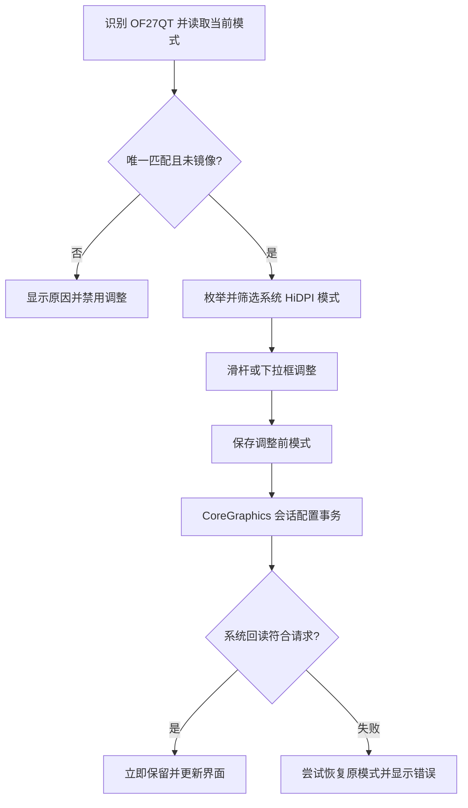

# MiniDisplay

针对 OF27QT 显示器的最小 macOS 原生 HiDPI 缩放工具，使用 Swift、AppKit 和 CoreGraphics 实现，无第三方依赖。

当前版本：0.2.0。滑杆和分辨率下拉框**调整即生效，无需再次确认**。

## 功能

- 自动识别唯一连接的 OF27QT（vendor `0x4c23` / product `0x2750`）。
- 枚举系统实际接受的 100 Hz、2× HiDPI 模式，在 1280 × 720 至 2560 × 1440 的候选范围内提供缩放。
- 连续滑杆和精确分辨率选择。
- 一键恢复程序启动时的显示配置。
- 应用失败时尝试恢复切换前模式，并显示错误。

已验证的 OF27QT 环境提供 80 档：1280 × 720 至 2544 × 1431。候选覆盖包含 2560 × 1440 HiDPI，但该环境没有开放这一档，因此不会显示在界面中。模式数量以系统实际返回为准。

本工具直接选择物理屏显示模式，不使用虚拟屏、镜像或画面串流，不调用 BetterDisplay 或其 helper。

## 构建与运行

需要 macOS 和 Xcode Command Line Tools：

```sh
git clone https://github.com/Xavier7776/betterdisplay.git
cd betterdisplay
./build.sh
open build/MiniDisplay.app
```

应用最低系统版本声明为 macOS 14；实际验证环境为 macOS 27 / Apple Silicon。构建结果采用本机 ad-hoc 签名，未公证，跨机分发尚未验证。

启动只读取当前模式。拖动滑杆或从下拉框选择后立即应用；没有倒计时或额外确认。设置在本次登录会话中保留，退出程序不会恢复；如需返回，点击“恢复启动时配置”。

程序只接受唯一匹配的、已激活且不在镜像组中的 OF27QT，其他型号不在当前版本范围内。

## HiDPI 模式覆盖

应用选择的是 macOS 已经开放的模式。如果系统已经有对应型号覆盖，可以直接使用，无需重复安装。

`Resources/DisplayProductID-2750` 是可独立生成的型号覆盖，不包含设备序列号或个人配置。生成命令：

```sh
python3 scripts/generate_override.py --output Resources/DisplayProductID-2750
```

生成逻辑：

```text
w = 1280, 1296, …, 2560；h = w × 9 / 16
BE32(2w, 2h, 9, 0x200000)
BE32(2w, 2h)
BE32(w, h)
```

81 个候选 HiDPI 尺寸去重后产生 242 条 `scale-resolutions` 记录。配置生成不代表系统一定接受全部候选。

如果系统缺少对应模式，可双击 `scripts/install-override.command`。它会通过 macOS 请求管理员授权，备份现有型号覆盖，再安装生成文件；不会自动重启或重新初始化显示器。安装后自行重启并检查模式是否开放。

目标路径：

```text
/Library/Displays/Contents/Resources/Overrides/DisplayVendorID-4c23/DisplayProductID-2750
```

备份保留在同目录，名称包含 `.minidisplay-backup-`。需要恢复时，将相应备份复制回目标路径，再重启。

覆盖使用未公开的系统配置格式；干净系统安装和重启激活尚未验证。当前仅针对该型号、100 Hz 和 2× HiDPI，不提供其他显卡、系统版本或显示器的兼容保证。

## 验证

基础检查，不修改显示模式：

```sh
./build.sh
python3 scripts/generate_override.py --compare Resources/DisplayProductID-2750
codesign --verify --strict build/MiniDisplay.app
```

在已经激活对应模式覆盖、连接唯一 OF27QT 的机器上，可以执行完整本机检查：

```sh
./verify.sh
```

验证内容包括：模式筛选和去重、滑杆及下拉自动提交、应用失败恢复、当前相同模式的真实 CoreGraphics 提交及回读、恢复启动时配置、前后显示状态和系统覆盖保持一致。

自动测试对其他档位使用记录型 writer；实际显示事务只将当前模式应用到自身，不会自动切到其他分辨率。界面预览仅渲染本应用的视图，不截取桌面。

运行记录生成在 `evidence/`，不纳入版本控制。其他分辨率的实际观感、窗口重排和长时间稳定性仍需使用者试用。

## 实现



- `Sources/MiniDisplay.swift`：原生界面、模式筛选、显示事务和自检。
- `inspect.swift`：只读显示状态检查器。
- `build.sh`：编译并签名 `.app`。
- `verify.sh`：适用于匹配硬件和配置的本机验证。
- `scripts/generate_override.py`：型号覆盖生成器及条目检查。
- `scripts/install-override.command`：用户授权后备份、安装覆盖。

使用公开的 [CGConfigureDisplayWithDisplayMode](https://developer.apple.com/documentation/coregraphics/cgconfiguredisplaywithdisplaymode(_:_:_:_:)) 事务接口。模式的 [pixelWidth](https://developer.apple.com/documentation/coregraphics/cgdisplaymode/pixelwidth) 是渲染像素，不能据此认定显示接口的传输时序。

本版不包含亮度/HDR 管理、虚拟屏、镜像、串流或开机自动调整。
